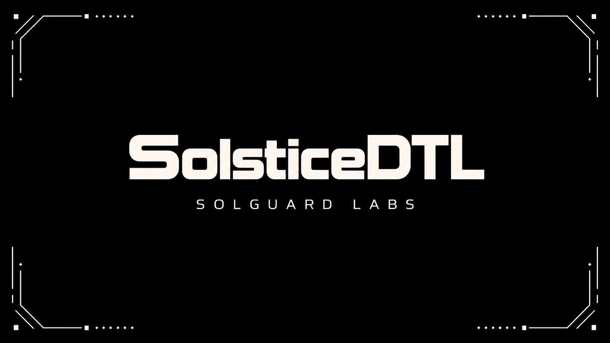
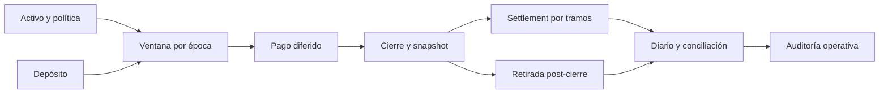

# SolsticeDTL



SolsticeDTL coordina depósitos y pagos diferidos en ventanas de liquidez por activo y época. El servicio Go registra claims por cuenta, reserva para pagos, cierra cada ventana con un snapshot contable y liquida tramos con comisiones explícitas. La CLI procesa escenarios JSON deterministas y ofrece un informe operativo de utilización, vencimientos y estimación del siguiente tramo.

## Funcionamiento



El cierre registra reserva, obligaciones abiertas y claims por cuenta. La ejecución posterior conserva tanto el snapshot como el estado vivo; cada tramo produce un importe bruto, una comisión calculada en puntos básicos y un neto para el beneficiario. La proyección de auditoría ordena pagos por vencimiento y prioridad y calcula el máximo tramo permitido por política sin modificar el ledger.

```text
comisión = min(max(ceil(tramo × fee_bps / 10 000), mínimo), máximo)
neto = tramo − comisión
outstanding posterior = outstanding anterior − tramo
```

La [descripción económica](docs/modelo-economico.md) desarrolla las unidades, claims, comisiones y ejemplos numéricos. El [ciclo de estados](docs/arquitectura.md) explica el aislamiento entre ventanas.

## Ejecutar

Requisitos: Go 1.22+ y Node.js 24+.

```bash
npm install
npm run build
bin/solsticedtl run tests/fixtures/partial_settlement.json --json
bin/solsticedtl audit tests/fixtures/partial_settlement.json --json
bin/solsticedtl validate tests/fixtures/deposit_close.json
npm test
```

En Windows use `bin/solsticedtl.exe` y, si PowerShell bloquea el alias de npm, `npm.cmd`. `audit` acepta también salida de texto, con una línea por ventana y por pago abierto. Los importes JSON son enteros en la unidad del activo, no números de coma flotante.

## Superficie de revisión

| Módulo | Responsabilidad |
| --- | --- |
| `src/domain`, `src/amount` | Entidades, vectores de balances y aritmética entera. |
| `src/engine`, `src/policy` | Transiciones de negocio y límites por operación. |
| `src/ledger`, `src/solvency` | Diario, snapshots y conciliación por activo. |
| `src/audit` | Score por ventana, hallazgos operativos y agenda de pagos. |
| `src/scenario`, `src/cmd` | Contrato JSON y CLI. |

- [Arquitectura y estados](docs/arquitectura.md)
- [Modelo económico](docs/modelo-economico.md)
- [Operación y recuperación](docs/operacion.md)
- [Contrato JSON](docs/contrato-json.md)
- [Política de seguridad](SECURITY.md)

La validación ejecuta `gofmt`, `go test`, `go vet`, build y pruebas TypeScript. Las ramas `main` y `production` y el tag anotado `v1.0.0` deben apuntar al mismo commit publicado. El programa local no conecta con custodios, redes externas ni activos de clientes.
