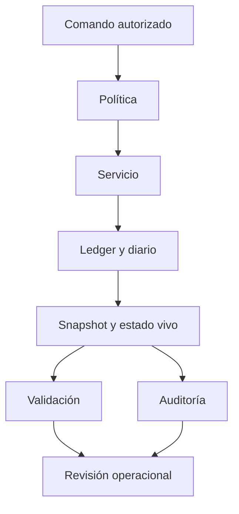

# Política de seguridad

## Modelo de confianza

El motor recibe comandos que una capa operativa externa habría autorizado. No gestiona claves, firmas, autenticación de usuarios ni liquidación en una red pública. Sus garantías comprobables se limitan al estado local, las validaciones de política, el diario y la salida determinista. Cualquier integración debe añadir autorización, conciliación externa y control de idempotencia.



## Controles

- Los IDs de activo, cuenta, ventana y pago se validan antes de mutar el estado.
- Los depósitos requieren una ventana abierta; los settlements, una ventana cerrada y un pago abierto en ella.
- El pago reservado se reduce por el bruto de cada tramo y el beneficiario recibe el neto; los fees se registran aparte.
- La política limita reserva máxima, pago máximo, tramo parcial, tarifa y retirada mínima.
- El cierre conserva un snapshot de reserva, outstanding y claims por cuenta; el reporte expone también los valores actuales.
- La agenda de auditoría es una estimación de lectura, ordenada por vencimiento y prioridad; no ejecuta ni reserva tramos.

Estos controles no constituyen una garantía de solvencia futura. La validación local y el score operacional no sustituyen una conciliación de fondos externos o una revisión independiente.

## Notificación responsable

Use el canal privado de avisos de seguridad de GitHub para compartir el commit, fixture mínimo, secuencia de comandos, estado esperado y observado, unidades del activo e impacto económico. Evite publicar datos sensibles o ejecutar pruebas sobre terceros.

```bash
go test ./...
go vet ./...
npm run ci
bin/solsticedtl audit tests/fixtures/partial_settlement.json --json
```

Los [límites del modelo](docs/modelo-economico.md) y la [guía de operación](docs/operacion.md) detallan las comprobaciones antes de integrar el servicio.
