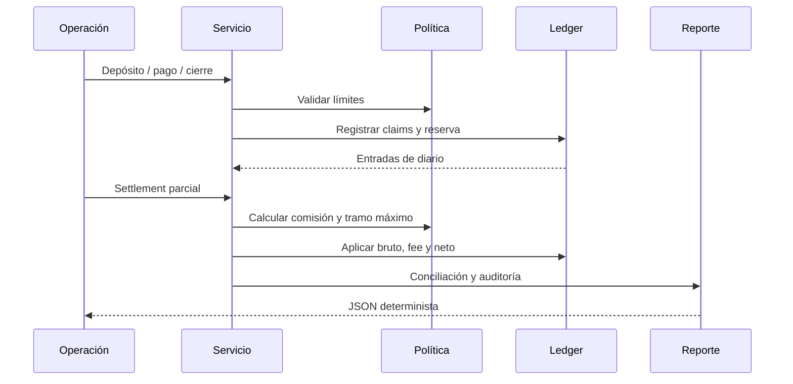
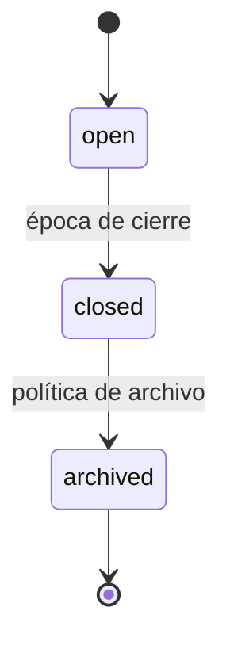

# Arquitectura y estados

SolsticeDTL divide el estado por ventanas de un solo activo. Una ventana conoce el intervalo de épocas, depósitos, retiradas, pagos y un snapshot opcional de cierre. Las cuentas mantienen vectores separados de saldo libre, reservado, recibido, retirado y fees. El diario indexa sus entradas por cuenta, ventana, pago y activo.

Los pagos pasan de `queued` a `settling` después del primer tramo y a `settled` al consumir todo el outstanding. Un pago conserva una lista de tramos con bruto, fee, neto, operador y época. El servicio exige que el ID de ventana de un settlement coincida con el pago y que no se exceda el máximo parcial definido por política.

La auditoría (`audit`) reconstruye métricas de ventana y una agenda de pagos abiertos. Ordena por `dueEpoch` ascendente, `priority` descendente y `paymentId` como desempate estable. La agenda no crea reservas ni avanza épocas; su cálculo se repite desde el estado resultante del escenario proporcionado.

Los snapshots preservan la vista al cierre para revisión histórica. El estado vivo continúa variando por settlements, comisiones y retiradas; ambas vistas se exponen separadamente en el JSON.
