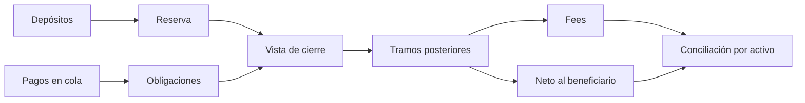

# Modelo económico

El ledger opera con enteros no negativos. Cada activo indica sus decimales, pero el JSON conserva importes en unidades base. Un parser no debe convertirlos a coma flotante antes de conciliar. `10 000 bps` equivale al 100 %.

## Claims y obligaciones

Un depósito `D` aumenta la reserva de la ventana y el saldo libre de la cuenta. Encolar un pago `P` mueve `P` de libre a reservado sin cambiar la reserva. Al liquidar un tramo bruto `G` con comisión `F`, se consume `G` de reservado, el beneficiario registra `G − F` recibido y la ventana disminuye su reserva por `G + F` según el asiento de settlement. El outstanding del pago disminuye en `G`.

```text
outstanding = importe original − suma de tramos brutos
fee = clamp(ceil(G × fee_bps / 10 000), fee_mínimo, fee_máximo)
neto beneficiario = G − fee
tramo máximo = floor(outstanding × max_partial_bps / 10 000)
```

La agenda de auditoría estima el siguiente tramo con las mismas reglas de tarifa y parcialidad. Es una proyección informativa: no reserva capacidad de ventana ni sustituye las comprobaciones durante `Settle`.

Ejemplo: un pago de `900` con tarifa `300 bps` se liquida parcialmente por `200`. La comisión es `6`, el neto `194` y quedan `700` pendientes. Si el máximo parcial es `10 000 bps`, el siguiente tramo estimado es `700`, con tarifa `21` y neto `679`.

## Ventanas y conciliación

El cierre registra `reserve`, `outstanding`, claims libres/reservados y margen del instante de cierre. Los reportes de ventana muestran también reserva, outstanding, volumen y fees actuales. La conciliación por activo agrega ventanas y cuentas sin mezclar denominaciones; `closedMargin` es la suma de márgenes históricos de cierre, no una tasación actual.



No se modelan precios de mercado, riesgo de custodia, fees de red o finalización externa. Una integración debe conciliar esos elementos por separado.
