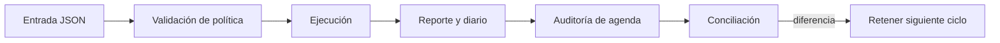

# Operación y recuperación

## Ciclo recomendado

1. Conservar commit, versión de Go/Node y fixture de entrada.
2. Ejecutar `npm run ci` tras cualquier cambio en lógica o documentación contractual.
3. Procesar el escenario con `run ... --json` y archivar el informe por activo/ventana.
4. Consultar `audit ... --json` para revisar utilización, vencimientos y estimación de fees antes del siguiente ciclo.
5. Ejecutar `validate` y comparar reserva, outstanding, claims y diario con la conciliación externa de la integración.



Los indicadores a revisar son: ventanas próximas a cerrar, pagos vencidos, utilización elevada, crecimiento de fees, cambios de claims por cuenta y discrepancias entre `closedMargin` y el estado corriente. Un mensaje `ok` de `validate` significa que sus comprobaciones internas pasaron; no confirma una transferencia externa.

Si aparece una diferencia, detenga el siguiente ciclo operativo, preserve fixture e informes y reconstruya la secuencia por cuenta, pago, ventana y activo mediante el diario. No reenvíe la misma orden a un custodio sin una clave de idempotencia definida por la integración. El ejecutable local no ofrece reversión de pagos externos.

```bash
bin/solsticedtl run tests/fixtures/multi_window.json --json
bin/solsticedtl audit tests/fixtures/partial_settlement.json --json
bin/solsticedtl validate tests/fixtures/deposit_close.json --json
```
